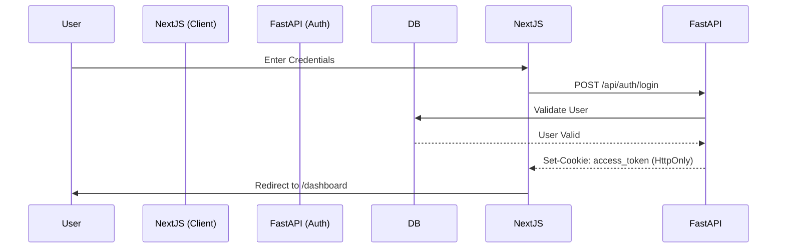
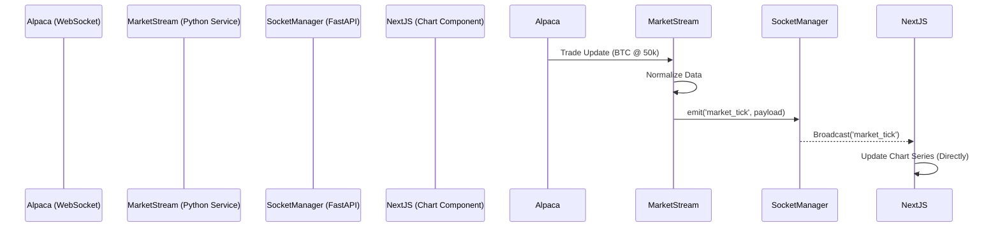
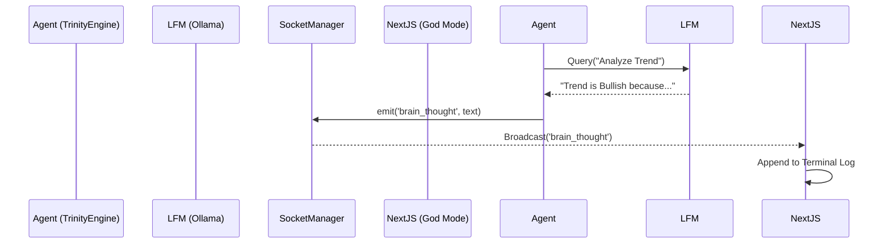
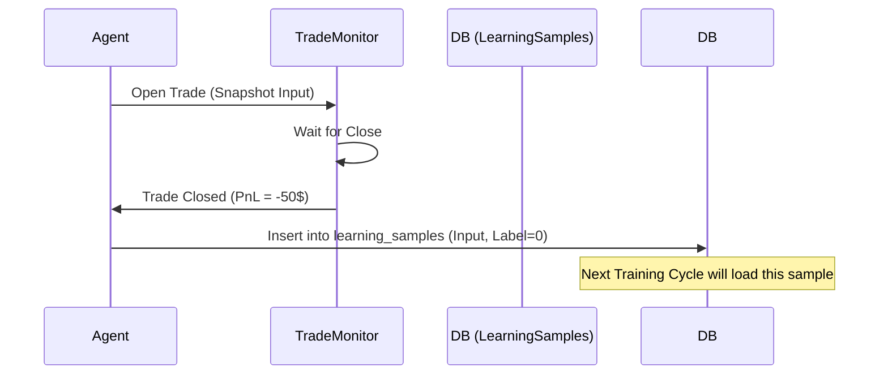

# System Data Flows

## 1. Authentication Flow (Login)

## 2. Real-time Market Data Flow
From Alpaca to the Chart (Zero Latency path).

## 3. "The Brain" Decision Flow
How the FleetAdmiral broadcasts thoughts to God Mode.

## 4. Active Learning Loop
Self-correction mechanism.

